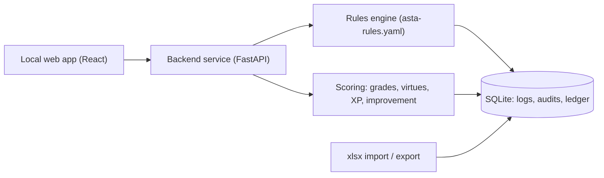

# High-level design

## System boundary

The system runs only on the user's machine. A local React app talks to a local FastAPI backend, which owns all rules, scoring, and persistence in a local SQLite database. There is no broker, cloud, or external market-data connection in v1.

## Components

| Component | Responsibility |
| --- | --- |
| Web app | Daily Dojo, gates, audit, reviews, character, dashboard; no business rules |
| Backend API | Versioned REST endpoints under `/api/v1`; validation; orchestration |
| Rules engine | Loads the versioned ASTA rules (thresholds, locks, risk band) and evaluates them deterministically |
| Scoring | Grades, Discipline %, virtues, XP events, levels, improvement verdicts |
| Store | SQLite with an append-only XP ledger; every record keeps the rules version used |
| Import/export | Seeds from the sanskar journal spreadsheets; exports to Excel |

## Key flows

1. **Morning:** rituals and checklist items are recorded; the readiness score is computed; the Trade Gate state is derived from readiness and active locks.
2. **Trade:** a plan is validated against the risk band and active locks before it is stored.
3. **Close:** an audit produces a grade and quadrant; the 3:30 PM scorecard computes Discipline %, applies locks, and appends XP events.
4. **Review:** weekly and monthly rollups feed the virtues and improvement engines.

## Design rules

- Profit and loss never feed XP, levels, virtues, or improvement verdicts.
- Rule changes are versioned; past scores keep the version they were computed with.
- All computations are pure functions over stored records so they can be replayed in tests.
