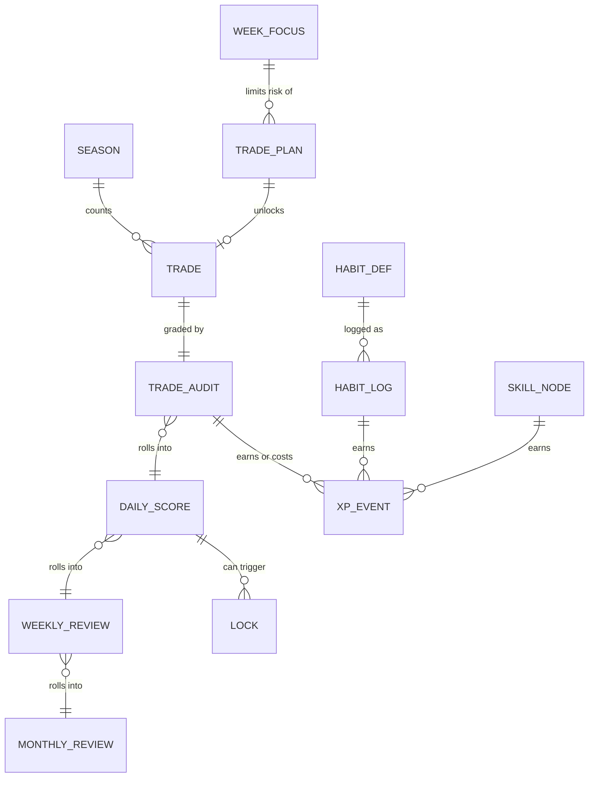

# Low-level design

## Proposed layout

```text
src/sanskar_dojo_api/
  app.py          FastAPI app and routers
  models.py       Pydantic request/response contracts
  rules.py        Load and validate asta-rules.yaml
  store.py        SQLite access
  scoring/        grades, discipline, virtues, xp, improvement
tests/
frontend/         React + Vite + TypeScript + Ant Design
config/asta-rules.yaml
```

## Core data model



| Entity | Key fields |
| --- | --- |
| HabitDef | id, label, minutes, cadence (daily, weekend, monthly), active |
| HabitLog | habit_id, date, done, minutes_spent |
| WeekFocus | week_start, capital, brick_size, risk_min, risk_max, strategies |
| TradePlan | id, date, setup, weapon_candle, entry, stop_loss, quantity, risk_amount, loss_accepted |
| Trade | plan_id, sl_proof, exit_price, pnl (display only) |
| TradeAudit | trade_id, sl_set, sl_moved, manual_exit, exit_reason, emotion, lesson, grade, quadrant |
| DailyScore | date, discipline_pct, readiness, virtues, rules_version |
| Lock | type (red_zone, capital), start_date, release_rule, released_at |
| WeeklyReview | week_start, role_ratings, screen_time, avg_pl_ratio, mood, improvement |
| MonthlyReview | month, theme, theme_worked, swot |
| SkillNode | module (SMM, PAPA, GUE, FOME, ...), progress_pct |
| Season | name, trade_target, risk_per_trade, loss_budget |
| XpEvent | id, at, source, reason, points, rules_version (append-only) |

## API conventions

- Prefix `/api/v1`; JSON only; ISO dates in the Asia/Kolkata market calendar.
- Every computed response includes the `rules_version` used.
